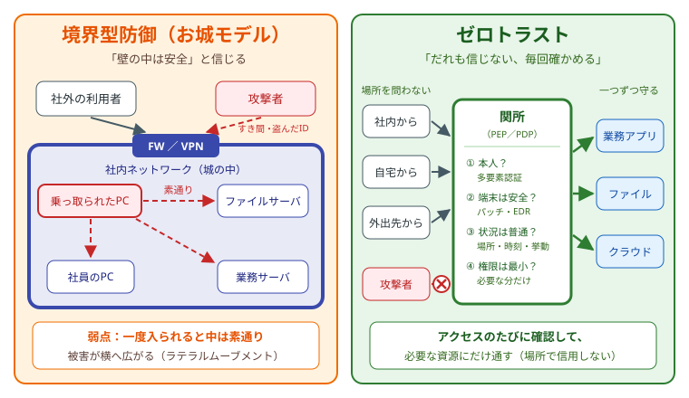
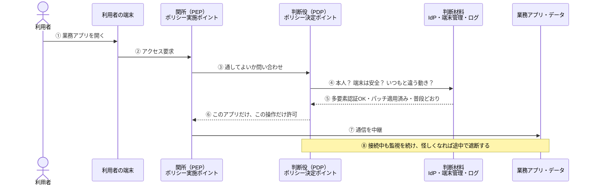
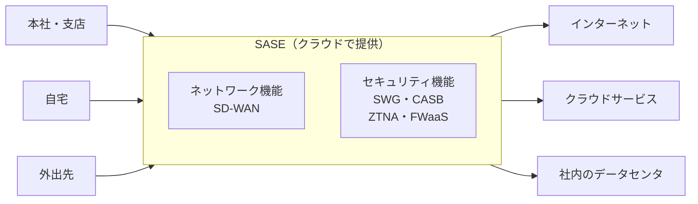

# ゼロトラストとは

!!! info "このノートの位置づけ"
    - **テキスト**：1.7 ゼロトラストとSASE（関連：1.6 テレワークとセキュリティ／6.1 アクセス制御）
    - **頻出度**：★★★（テレワーク・クラウドの長文問題の土台になる）
    - **作成日**：2026-11-24
    - **きっかけの質問**：ゼロトラストってなに？

## ひとことで

**ゼロトラスト**は、「社内ネットワークの中だから安全」とは考えず、**だれが・どの端末で・どこからアクセスしても、毎回きちんと確かめてから、必要な分だけ通す**というセキュリティの考え方。

合言葉は **Never trust, always verify（決して信頼せず、常に確認せよ）**。製品の名前ではなく、**設計の考え方**であることがポイント。

## たとえ話

=== "これまで：お城モデル（境界型防御）"

    お城のまわりに高い壁と堀があり、門番は城門だけにいる。門さえ通れば、城の中ではどの部屋にも自由に入れる。
    
    → もし敵が門番をだまして（あるいは壁のすき間から）入り込んだら、**城の中は歩き放題**。

=== "これから：ホテルモデル（ゼロトラスト）"

    ホテルでは、ロビーに入れても客室には入れない。部屋のドアごとにカードキーが必要で、そのカードは**自分の部屋だけ**、しかも**チェックアウトまで**しか使えない。怪しい動きがあればカードはすぐ止められる。
    
    → 一人が悪さをしても、**被害はその部屋の範囲で止まる**。

## 図解

{ loading=lazy }

## なぜ必要になったのか

境界型防御は「守るべきものは社内にあり、利用者も社内にいる」ことが前提だった。その前提が崩れた。

| 変化 | 境界型防御で困ること |
|---|---|
| **クラウド**（SaaSなど）の利用が当たり前に | 大事なデータが壁の**外**にある |
| **テレワーク**や外出先からの仕事が増えた | 利用者も壁の**外**にいる。全員がVPNで社内を経由すると混雑する |
| 標的型攻撃やランサムウェアの巧妙化 | フィッシングやVPN装置の脆弱性から**一度入られると、中は素通り**で被害が広がる |
| 内部不正 | そもそも「中の人」が悪さをする場合を防げない |

「壁の中か外か」で信用を決めるやり方は、もう通用しない。そこで **アクセスのたびに、本人・端末・状況を見て判断する** 方式に切り替える、というのがゼロトラスト。

## 仕組み

米国NIST（国立標準技術研究所）の文書 **SP 800-207** が、ゼロトラストの考え方と構成を整理している。試験でもこの用語が下敷きになる。

1. **利用者が資源にアクセスしようとする**。社内からでも自宅からでも、扱いは同じ。
2. **関所（PEP：Policy Enforcement Point）** がいったん止め、**判断役（PDP：Policy Decision Point）** に問い合わせる。
3. PDPは、いろいろな**判断材料**を集める。
    - **本人の確認**：IdP（ID管理と認証をまとめて行う仕組み）で**多要素認証**をする。
    - **端末の状態**：会社が管理している端末か、OSのパッチは当たっているか、EDR（端末の不審な動きを見張るソフト）は動いているか。
    - **状況**：いつもと違う国・時間帯からのアクセスではないか、普段と違う大量ダウンロードをしていないか。
4. ルール（ポリシー）に照らして、**必要な資源・必要な操作だけ**を許可する（**最小権限**）。
5. 許可は**1回きりではない**。接続中もログを見張り、状況が変われば認証をやり直させたり、遮断したりする（**継続的な検証**）。

### ゼロトラストを支える主な技術

| 技術 | ひとことで | ゼロトラストでの役割 |
|---|---|---|
| **IdP／IAM**（ID管理） | だれが何をしてよいかを一元管理 | 本人確認（多要素認証）、シングルサインオン |
| **MDM／EDR** | 端末の管理・監視 | 端末が安全かどうかの判断材料 |
| **ZTNA**（ゼロトラストネットワークアクセス） | アプリ単位で接続を許可する仕組み | VPNの代わりに、許可したアプリにだけつなぐ |
| **マイクロセグメンテーション** | ネットワークを細かく区切り、区画間の通信を制限 | 侵入されても横へ広がらないようにする |
| **SWG**（セキュアWebゲートウェイ） | クラウド上のWebプロキシ | 危険なサイトへのアクセスを止める |
| **CASB**（キャスビー） | クラウドサービスの利用を見える化・制御 | 許可していないSaaSの利用（シャドーIT）や情報の持ち出しを防ぐ |
| **SIEM**（シーム） | いろいろなログを集めて相関分析 | 継続的な監視、怪しい動きの検知 |

## SASEとの関係

**SASE**（サシー：Secure Access Service Edge）は、**ネットワークの機能とセキュリティの機能を、まとめてクラウドから提供する**サービスの形。2019年に調査会社ガートナーが提唱した。

- 以前は、拠点や自宅からの通信を**いったん本社に集めて**、本社のファイアウォールなどで検査していた。これだと本社の回線が混み、クラウドへのアクセスが遅くなる。
- SASEでは、利用者は**近くのSASEの拠点（クラウド）につなぐだけ**で、そこで検査されて目的地に向かう。
- ネットワーク部分を除いた**セキュリティ機能だけ**のサービスを **SSE**（Security Service Edge）と呼ぶ。

!!! tip "ゼロトラストとSASEの関係"
    **ゼロトラスト＝考え方（設計思想）**、**SASE＝それを実現しやすくするサービスの形**。SASEを導入すればゼロトラストが完成する、というわけではない（ID管理や端末管理、ポリシーの整備も必要）。

## 似ている用語との違い

### 境界型防御とゼロトラスト

| 項目 | 境界型防御 | ゼロトラスト |
|---|---|---|
| 信用の決め方 | **場所**（社内ネットワークの中なら信用） | **毎回の確認結果**（本人・端末・状況） |
| 守る単位 | ネットワーク全体（壁の内側） | 一つ一つの資源（アプリ・データ） |
| 確認のタイミング | 入るときに1回 | **アクセスのたび＋接続中も継続** |
| 侵入されたとき | 中は素通りで被害が広がりやすい | 最小権限と区画分けで被害を小さくする |
| 主な道具 | ファイアウォール、VPN、DMZ | IdP（多要素認証）、ZTNA、EDR、SIEM |
| 前提 | 「中は安全、外は危険」 | 「中も外も危険（すでに侵入されているかも）」 |

### VPNとZTNA

| 項目 | VPN | ZTNA |
|---|---|---|
| つながる範囲 | 社内ネットワーク**全体**に入れる | 許可された**アプリだけ** |
| 確認 | 接続時に1回 | アプリへのアクセスごと、継続的に |
| 外部への露出 | VPN装置がインターネットに公開される（脆弱性を狙われやすい） | アプリをインターネットから見えなくできる |
| 通信の経路 | 本社に集中しやすい | クラウド経由で分散しやすい |

## 試験での出方

!!! question "科目A-2"
    - 「**ゼロトラストの考え方に基づく対策**として適切なものはどれか」。ダミーとして「社内LANからのアクセスは認証を省略する」など、**場所で信用する**選択肢が混ざる。
    - 「SASEの説明はどれか」「CASBの説明はどれか」「SWGの説明はどれか」など、用語の意味を問う。SDP、SD-WAN、EDRなどの略語も並びやすい。
    - 「マイクロセグメンテーションの目的はどれか」→ 侵入後の**横展開（ラテラルムーブメント）の防止**。

!!! question "科目B"
    - テレワークやクラウドへの移行を題材に、「VPNをやめてZTNAにする」「IdPで多要素認証と条件付きアクセスを入れる」といった**移行計画**が示され、そのねらいや残るリスクを記述させる。
    - 「端末の状態（パッチ適用状況など）を確認してからアクセスを許可する」設計で、**どの情報をどこから取るか**、**不適合な端末をどう扱うか**を問う。
    - 侵入された想定の事例で、「境界型防御のままだとなぜ被害が広がったか」を説明させる。

!!! warning "ひっかけポイント"
    - **ゼロトラストは製品名ではない**。「〇〇という機器を入れればゼロトラスト」ではない。
    - **ファイアウォールを全部捨てる、という意味ではない**。境界の防御も残しつつ、「境界だけに頼らない」のがゼロトラスト。
    - **一度認証したら終わり、ではない**。継続的に確認し続けるのが特徴。「最初に強く認証すれば、その後は確認不要」は誤り。
    - **社内からのアクセスも確認する**。「社内は信頼して、社外だけ厳しく確認」は境界型の考え方。
    - **SASE＝ゼロトラスト、ではない**。SASEは実現手段の一つ。

## 参考になる外部資料

図は載せず、リンクと見どころだけ紹介する。

- [NIST SP 800-207 Zero Trust Architecture](https://csrc.nist.gov/pubs/sp/800/207/final)（英語）：ゼロトラストの「原典」。PDP・PEPなどの構成要素と、ゼロトラストの基本原則が整理されている。試験の用語の出どころ。
- [デジタル庁「標準ガイドライン群」](https://www.digital.go.jp/resources/standard_guidelines)：「ゼロトラストアーキテクチャ適用方針」（DS-210）など、政府システムでの考え方を日本語で読める。属性に基づいてアクセスを決める方式（ABAC）の技術レポートもある。
- [IPA「ゼロトラスト導入指南書」](https://www.ipa.go.jp/jinzai/ics/core_human_resource/final_project/2021/zero-trust.html)：導入のときの注意点を日本語でまとめた資料。公開から時間がたっていて、IPAのページでも参考資料扱いになっている点に注意。

## 確認ミニ問題

**問1** ゼロトラストの考え方に基づく対策として、最も適切なものはどれか。

- ア　社内LANに接続された端末からのアクセスは、利用者認証を省略して業務システムの利用を許可する
- イ　VPNで社内LANに接続した利用者には、社内LAN上の全てのサーバへのアクセスを許可する
- ウ　アクセスのたびに利用者の認証と端末の状態の確認を行い、業務に必要な資源へのアクセスだけを許可する
- エ　インターネットとの境界にファイアウォールを二重に設置し、境界の内側の通信は監視の対象外とする

??? success "答えと解説（タップで開く）"
    **正解：ウ**

    - ア：「社内だから信用する」のは境界型防御の考え方。
    - イ：VPNでつないだら全部見える、は境界型。ゼロトラストでは最小権限で、必要な資源だけを許可する。
    - ウ：**正解**。毎回確認する・最小権限、の2つがそろっている。
    - エ：境界を強くしても、中を監視しないなら境界型のまま。

**問2** SASEの説明として、最も適切なものはどれか。

- ア　利用者が契約していないクラウドサービスの利用を検知し、制御する仕組み
- イ　SD-WANなどのネットワーク機能と、SWGやZTNAなどのセキュリティ機能を統合し、クラウドサービスとして提供する形態
- ウ　ネットワークを細かい区画に分け、区画の間の通信を必要最小限に制限する手法
- エ　さまざまな機器のログを集めて相関分析し、セキュリティ上の異常を検知する仕組み

??? success "答えと解説（タップで開く）"
    **正解：イ**

    - ア：CASB の説明。
    - イ：**正解**。ネットワーク＋セキュリティをクラウドからまとめて提供するのがSASE。
    - ウ：マイクロセグメンテーションの説明。
    - エ：SIEM の説明。

**問3** テレワーク用のリモートアクセスを、VPNからZTNAに切り替えることにした。VPNと比べて、攻撃者に端末を乗っ取られた場合の被害を小さくできる理由を、40字以内で答えよ。

??? success "答えと解説（タップで開く）"
    **解答例**：社内ネットワーク全体ではなく、許可されたアプリだけにしか接続できないから。（37字）

    VPNは一度つながると社内ネットワークの中を広く見渡せるので、乗っ取られた端末から横へ広がりやすい。ZTNAはアプリ単位で許可するので、到達できる範囲が限られる。さらにアクセスのたびに端末の状態も確認するので、異常があれば途中で止めやすい。

## 関連ノート

- [第1章 情報セキュリティ及びITの基礎](index.md)
- [第6章 アクセス制御と認証](../ch06/index.md)
