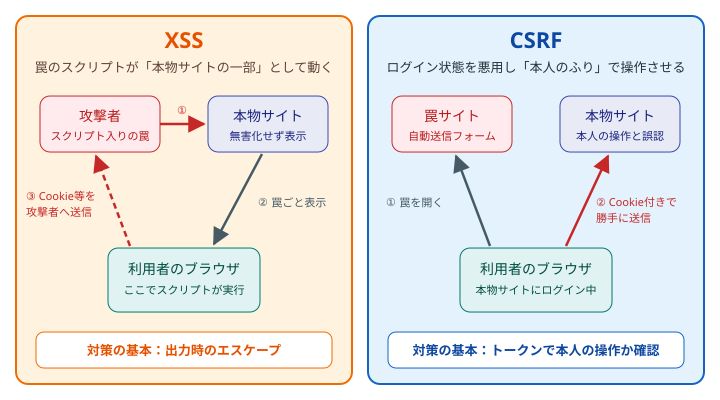

# XSSとCSRFの違い

!!! info "このノートの位置づけ"
    - **テキスト**：2.8 Webアプリケーションに不正なスクリプトや命令を実行させる攻撃／3.6 HTTP及びWebアプリケーションの脆弱性と対策
    - **頻出度**：★★★（科目A-2でも科目Bでもよく出る）
    - **作成日**：2026-11-24

## ひとことで

- **XSS**（クロスサイト・スクリプティング）：攻撃者のスクリプトを、**本物サイトのページの一部として利用者のブラウザで動かす**攻撃。
- **CSRF**（クロスサイト・リクエスト・フォージェリ）：ログイン中の利用者に、**本人が意図しないリクエストを本物サイトへ送らせる**攻撃。

いちばん大事な違いは「**どこで悪さが起きるか**」。XSSは利用者の**ブラウザの中**で、CSRFは**本物サイトのサーバ側**で悪さが起きる。

## たとえ話

=== "XSS"

    お店（本物サイト）の掲示板に、客がチラシを貼れるとする。店員が中身を確認せずに貼り出すと、チラシに仕込まれた「これを読んだ人は財布を外に出せ」という命令を、読んだ客が実行してしまう。**お店の信用を借りて、客に悪さをする**イメージ。

=== "CSRF"

    銀行の窓口で、あなたは顔パスで手続きできる常連さん（ログイン中）。誰かがあなたのポケットに「〇〇さんへ100万円送金」と書いた依頼書を忍ばせ、あなたが知らないうちに窓口へ出してしまう。銀行は「常連さんの依頼だ」と思って処理する。**本人の信用を借りて、勝手に手続きする**イメージ。

## 全体図

{ loading=lazy }

## 仕組み

=== "XSS（反射型の例）"

    ```mermaid
    sequenceDiagram
        actor 攻撃者
        actor 利用者
        participant ブラウザ as 利用者のブラウザ
        participant 本物 as 本物サイト
        攻撃者->>利用者: ① スクリプト入りのURLをメールなどで送る
        利用者->>ブラウザ: ② URLをクリック
        ブラウザ->>本物: ③ スクリプト入りのリクエスト
        本物-->>ブラウザ: ④ 入力値をエスケープせずにページへ埋め込んで返す
        Note over ブラウザ: ⑤ スクリプトが「本物サイトのもの」として実行される
        ブラウザ->>攻撃者: ⑥ Cookie（セッションID）などが送られる
    ```

    1. 攻撃者が、スクリプトを仕込んだURLや投稿を用意する。
    2. 本物サイトが、その入力値を**無害化（エスケープ）せずに**ページに出力する。
    3. 利用者のブラウザは、それを本物サイトのスクリプトだと思って実行する。
    4. Cookieを盗まれたり、偽の入力フォームを表示されたりする。

    XSSには3つの型がある。

    | 型 | スクリプトの置き場所 |
    |---|---|
    | 反射型 | リクエスト（URLなど）に含まれ、そのまま返ってくる |
    | 格納型（持続型） | 掲示板などのデータベースに保存され、見た人全員に表示される |
    | DOMベース | サーバを通らず、ブラウザ側のJavaScriptの処理だけで発生する |

=== "CSRF"

    ```mermaid
    sequenceDiagram
        actor 利用者
        participant ブラウザ as 利用者のブラウザ
        participant 罠 as 罠サイト
        participant 本物 as 本物サイト
        ブラウザ->>本物: ① 普通にログイン（Cookieにセッションが保存される）
        利用者->>ブラウザ: ② ログインしたまま罠サイトを開く
        罠-->>ブラウザ: ③ 自動で送信されるフォームを返す
        ブラウザ->>本物: ④ 送金リクエスト（Cookieが自動で付く）
        Note over 本物: ⑤ 本人の操作だと誤認して処理してしまう
    ```

    1. 利用者が本物サイトにログインし、ブラウザにセッションのCookieが保存される。
    2. ログインしたまま、攻撃者の罠サイトを開く。
    3. 罠サイトのフォームが、本物サイトへのリクエストを自動で送る。
    4. ブラウザはそのリクエストに本物サイトのCookieを**自動で付けてしまう**。
    5. 本物サイトは本人の操作だと思い、送金・退会・パスワード変更などを実行する。

## 対策

| | 根本的な対策 | 保険的な対策 |
|---|---|---|
| **XSS** | 出力するときに `<` `>` `&` `"` などを**エスケープ**する | CSP（読み込めるスクリプトを制限）、Cookieの**HttpOnly**属性（スクリプトからCookieを読めなくする）、入力値チェック |
| **CSRF** | 推測できない**トークン**を画面に埋め込み、送られてきた値と照合する／重要な操作の前にパスワードを再入力させる／Refererを確認する | Cookieの**SameSite**属性、重要な処理をしたら登録メールアドレスへ通知する |

## 比較表

| 項目 | XSS | CSRF |
|---|---|---|
| 悪さが起きる場所 | 利用者のブラウザ | 本物サイト（サーバ側の処理） |
| 悪用するもの | サイトが入力値を無害化しない欠陥 | 「Cookieが自動で送られる」ブラウザの仕組みと、本人確認の甘さ |
| 攻撃者のスクリプトが本物サイト上で動くか | **動く** | 動かない |
| 攻撃者が結果の画面を読めるか | 読める（Cookieや画面の内容を盗める） | 読めない（同一オリジンポリシーで阻まれる） |
| ログインが前提か | 前提ではない（ログイン中なら被害が大きい） | **前提** |
| 典型的な被害 | Cookie（セッションID）の盗難、偽フォームの表示 | 意図しない送金・購入・退会・設定変更・書込み |
| 代表的な対策 | 出力時のエスケープ、CSP、HttpOnly | トークン、パスワード再入力、SameSite |

## 試験での出方

!!! question "科目A-2"
    - 「〇〇の説明はどれか」で、XSS・CSRF・SQLインジェクション・セッションハイジャックの説明が選択肢に並ぶ。
    - 「CSRFの対策として適切なものはどれか」で、エスケープ（XSSの対策）やプレースホルダ（SQLインジェクションの対策）がダミーとして混ざる。

!!! question "科目B"
    - 画面遷移図やHTMLのソースが示され、「どの値をトークンとして使えばよいか」「なぜその値では対策にならないか」を記述させる。
    - CSPの設定（`script-src` など）を読み取り、どの攻撃をどこまで防げるかを答えさせる。令和7年度秋期の問1でもCSPが出題され、IPAの採点講評では正答率がやや低かったとされている。

!!! warning "ひっかけポイント"
    - **HttpOnlyはXSSそのものを防ぐ対策ではない**。スクリプトからCookieを読めなくして、被害を小さくするだけ。
    - **XSSの脆弱性があると、CSRF対策のトークンも盗まれる**。スクリプトがページ内のトークンを読み取れるから。CSRF対策はXSS対策とセットで考える。
    - CSRFの攻撃者は、送らせたリクエストの**結果を読めない**。「CSRFで画面の情報を盗む」という選択肢は誤り。

## 参考になる外部資料

図は載せず、リンクと見どころだけ紹介する。

- [IPA「安全なウェブサイトの作り方」1.5 クロスサイト・スクリプティング](https://www.ipa.go.jp/security/vuln/websecurity/cross-site-scripting.html)：XSSの脅威と、根本的解決・保険的対策の区別が整理されている。試験の対策の分類と同じ考え方。
- [IPA「安全なウェブサイトの作り方」1.6 CSRF](https://www.ipa.go.jp/security/vuln/websecurity/csrf.html)：注意が必要なサイトの特徴（Cookieによるセッション管理、Basic認証など）がまとまっている。
- [IPA「安全なウェブサイトの作り方」トップ](https://www.ipa.go.jp/security/vuln/websecurity/about.html)：SQLインジェクションやクリックジャッキングなど、ほかのWeb脆弱性もまとめて見られる。

## 確認ミニ問題

**問1** CSRFの対策として最も適切なものはどれか。

- ア　ページに出力する文字列の `<` や `>` をHTMLエンティティに置き換える
- イ　CookieにHttpOnly属性を付ける
- ウ　推測困難な値を画面に埋め込み、リクエストに含まれる値と照合する
- エ　SQL文の組立てにプレースホルダを使う

??? success "答えと解説（タップで開く）"
    **正解：ウ**

    - ア：XSSの根本的な対策（出力時のエスケープ）。
    - イ：XSSでCookieを盗まれにくくする保険的な対策。
    - ウ：**正解**。罠サイトはこの値を知ることができないので、正規の画面からの操作かどうかを見分けられる。
    - エ：SQLインジェクションの対策。

**問2** CSRF攻撃では、攻撃者は利用者に送金のリクエストを送らせることはできても、送金完了の画面の内容を読み取ることはできない。その理由を30字以内で答えよ。

??? success "答えと解説（タップで開く）"
    **解答例**：同一オリジンポリシーにより、罠サイトから応答を読めないから。（30字）

    ブラウザは、あるサイト（オリジン）のスクリプトが、別のサイトの応答の中身を読むことを制限している。リクエストは送れても、返ってきた画面は罠サイト側から見えない。

## 関連ノート

- [第2章 情報セキュリティにおける脅威](../ch02/index.md)
- [第3章 情報セキュリティにおける脆弱性](index.md)
